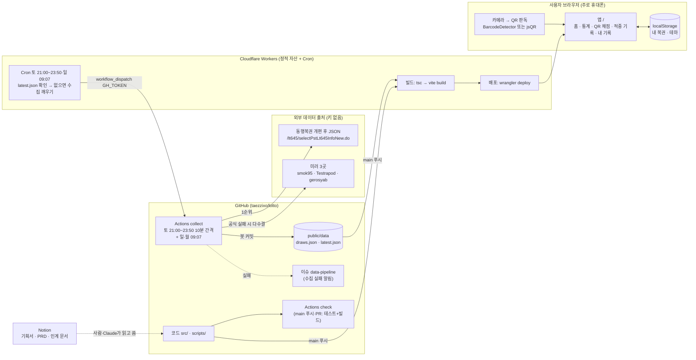
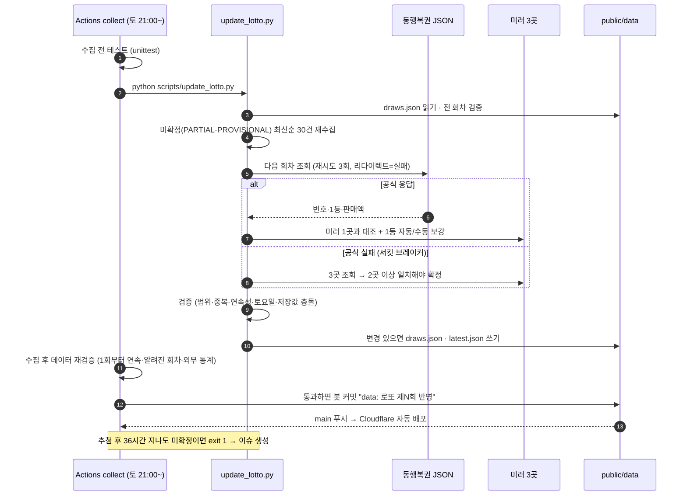
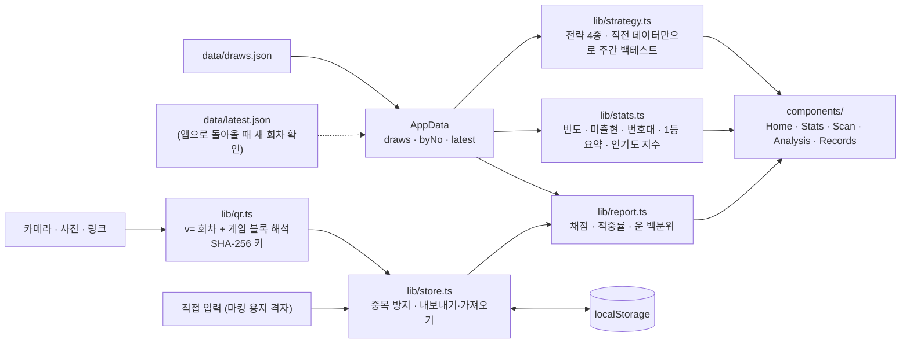

# 로또 데이터 실험실 시스템 구성도

[기본 구성도 v1](https://app.notion.com/p/4176a73e155981319a03eaf08784f44f)(청약맵 기준 「새 대시보드 레퍼런스」)을 로또 데이터 실험실에 맞게 옮긴 문서입니다. 기본 구성도의 원칙(서버 없음, 예약 수집, JSON 커밋, 자동 배포, 계산은 브라우저)은 그대로 따릅니다. 달라진 점은 §0에 모았습니다.

- 작성 기준일: 2026-11-18. 버전: v0.1(MVP)
- 그림은 Mermaid 코드 블록입니다. GitHub에서는 바로 보이고, Notion에서는 코드 블록의 「미리보기」를 누르면 보입니다.

## 0. 기본 구성도 대비 달라진 점

| # | 항목 | 청약맵 | 로또 데이터 실험실 |
| --- | --- | --- | --- |
| 1 | 저장소 | `dash_housing` 공개 | `taezzixo/lotto` |
| 2 | 수집 주기 | 매일 06:17 KST | **토 21:00~23:50 KST 10분 간격** + 일·월 09:07 백스톱(추첨이 토 20:35). GitHub 예약이 몇 시간씩 밀려서(2026-11-21 약 7시간) **Cloudflare Cron Trigger가 같은 시각에 사이트 데이터를 보고 최신 회차가 없을 때만 `workflow_dispatch`로 수집을 깨움**(`worker/index.ts`, 2026-11-22) |
| 3 | 출처 | 공공데이터포털 API(키 필요) | 동행복권 개편 후 JSON(1순위) + 독립 미러 3곳(smok95, Testrapod, gerosyab) 다수결. **키 없음, Secrets 불필요**(비상용 `LOTTO_OFFICIAL_BASE`만 선택) |
| 4 | 수집 스크립트 | Node `fetch-notices.mjs` | **Python 표준 라이브러리** `scripts/update_lotto.py`(의존성 0, 단위 테스트 13개) |
| 5 | 핵심 항목 | `Notice` | `Draw`. 고정 id = 회차 번호, 출처(`source`), 품질(`status`: COMPLETE·PARTIAL·PROVISIONAL), 날짜(`date`). 위치·원문 링크는 해당 없음 |
| 6 | 0건 가드 | 직전 5건 이상인데 0건이면 실패 | 회차 연속성·범위·중복·토요일 검증 + **저장값과 번호가 달라지면 중단**(정정 감지) + 소스 간 불일치 시 중단 |
| 7 | 메인 화면 | 카카오 지도 | 최신 회차 공 + 카운트다운 + 이번 주 내 복권. 지도 SDK 없음 |
| 8 | 브라우저 계산 | 자격 판정·가점 | QR 해석, 채점, 운 백분위, 번호 빈도·미출현, 1등 인기도 지수, 전략별 주간 적중 백테스트 |
| 9 | 사용자 입력 | 소득·자산 → localStorage | 복권(QR·직접 입력·분석 번호) → localStorage `lotto-lab:tickets:v1`. **QR 원문(일련번호) 미저장**, SHA-256 해시만 |
| 10 | 계정 | Supabase(선택) | **없음**. JSON 내보내기·가져오기 |
| 11 | 데이터 크기 | 단일 파일 | `draws.json` 1개(1,250회, gzip 38KB) + 첫 화면 확인용 `latest.json` |
| 12 | SEO 페이지 | `/n/<id>` | `/r/<회차>/` 정적 페이지 + `/r/` 목록(`scripts/prerender.mjs`, 빌드 때 생성). `SITE_URL` 빌드 변수가 있으면 sitemap |
| 14 | 오프라인 | 없음 | **PWA 서비스 워커**(v0.2): 앱 셸·데이터 캐시, 오프라인에서도 통계·기록 열람 |
| 13 | 관리자 페이지 | `/admin.html` | v0.1 없음. 수집 실패는 GitHub 이슈(`data-pipeline` 라벨)로 알림 |

## 1. 전체 구성도



## 2. 주간 수집 파이프라인



상태 규칙: `COMPLETE`(공식 또는 미러 2곳 일치 + 1등 집계 완료), `PARTIAL`(번호만 확정), `PROVISIONAL`(미러 1곳). 1등 0명(이월)은 추첨 12시간 뒤 확정합니다. 자세한 내용은 [PRD §9](PRD.md)를 봅니다.

## 3. 브라우저 안에서 일어나는 일



설계 원칙
- **개인 기록은 서버로 가지 않습니다.** 채점 결과는 저장하지 않고 앱을 열 때마다 계산합니다. 그래서 데이터가 정정되어도 자동으로 맞춰집니다.
- **QR 원문은 저장하지 않습니다.** 일련번호(TR)가 들어 있어 해시(`key`)만 남깁니다.
- **색 하나에 의미 하나**(`docs/DESIGN_SYSTEM.md`): 분홍 = 주 동작·선택, 공 색 = 당첨번호만, 초록 = 당첨 상태(글자와 함께).
- **모든 통계·분석 화면에 확률 고지**(푸터 상시) + 당첨은 동행복권에서 확인하도록 안내.

## 4. 데이터 모델

| 형식 | 파일 | 요점 |
| --- | --- | --- |
| `Draw` | `src/types.ts`, `public/data/draws.json` | `no`, `date`, `nums[6]`, `bonus`, `first{winners, prize}`, `sales`, `firstType`, `status`, `source` |
| `Ticket` | `src/types.ts`, localStorage | `id`, `source`(qr·manual·analysis), `round`, `key?`, `createdAt`, `games[]` |
| `Game` | `src/types.ts` | `slot`(A~E), `type`(auto·manual·semi·pick), `nums[6]`, `strategy?` |

## 5. 저장소 구조

```txt
lotto/
├─ CLAUDE.md · README.md · wrangler.jsonc · index.html · vite.config.ts
├─ .github/workflows/deploy.yml   # check(main 푸시·PR) + collect(토요일 + 수동)
├─ public/
│  ├─ _headers                    # /data 10분, /assets 1년, sw.js no-cache, camera=(self)
│  ├─ manifest.webmanifest · sw.js · icons/   # PWA (앱 셸 오프라인)
│  └─ data/draws.json · latest.json
├─ scripts/
│  ├─ update_lotto.py             # 수집 (표준 라이브러리)
│  ├─ prerender.mjs               # 회차별 정적 페이지·robots·sitemap (빌드 후)
│  └─ test_update_lotto.py        # 수집·데이터 무결성 테스트
├─ worker/index.ts                # Cloudflare Worker: 정적 자산 + 토요일 밤 수집 깨우기(Cron)
├─ src/
│  ├─ App.tsx · main.tsx · types.ts · styles.css
│  ├─ components/                 # Home · Stats · Scan · Analysis · Records · ResultSheet · Ball · Slip · Charts · Icons
│  └─ lib/                        # lotto · qr · schedule · stats · report · strategy · store · format · collect (+ lib.test.ts)
└─ docs/                          # PRD · ARCHITECTURE · DESIGN_SYSTEM · HANDOFF · API_KEYS · PLAN_ORIGINAL
```

## 6. 키 배치

수집 자체에는 비밀 키가 없습니다. Cloudflare Worker가 GitHub 수집을 깨우는 데 `GH_TOKEN`(이 저장소 Actions 읽기·쓰기만 허용한 fine-grained 토큰) 하나를 Cloudflare 비밀값으로 씁니다. 동행복권이 해외 IP를 다시 막으면 국내 릴레이 주소를 GitHub Secret `LOTTO_OFFICIAL_BASE`에 넣습니다(선택). 목록은 [`docs/API_KEYS.md`](API_KEYS.md)에 있습니다.

## 7. 알려진 제약

- 이 작업 환경(클라우드 세션)의 네트워크 정책이 동행복권과 미러 호스트를 막고 있습니다. 시드 데이터는 미러 저장소를 git으로 받아 3곳을 대조해 만들었습니다. **실제 공식 엔드포인트 호출은 GitHub Actions 첫 실행에서 확인**해야 합니다.
- QR 형식은 오픈소스 파서 2종을 기준으로 구현했습니다. 실물 복권(자동·수동·반자동, 1~5게임)으로 검증해야 합니다.
- 예약 실행은 기본 브랜치(main)에서만 동작합니다. GitHub 예약은 지연·누락될 수 있어 Cloudflare Cron이 정시 깨우기를 맡고, GitHub 예약은 예비로 남겨 둡니다.
- 봇의 데이터 커밋(`GITHUB_TOKEN` 푸시)은 `check` 작업을 다시 돌리지 않습니다. 데이터에 기대는 테스트는 특정 회차가 "아직 추첨 전"이라고 가정하면 안 됩니다(2026-11-22 1251회 반영 뒤 한 건 수정).
