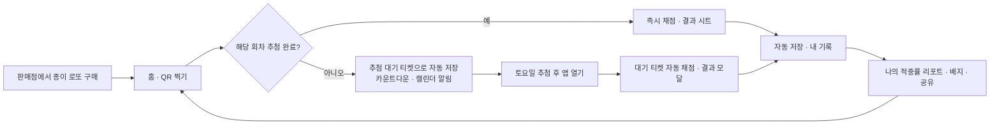
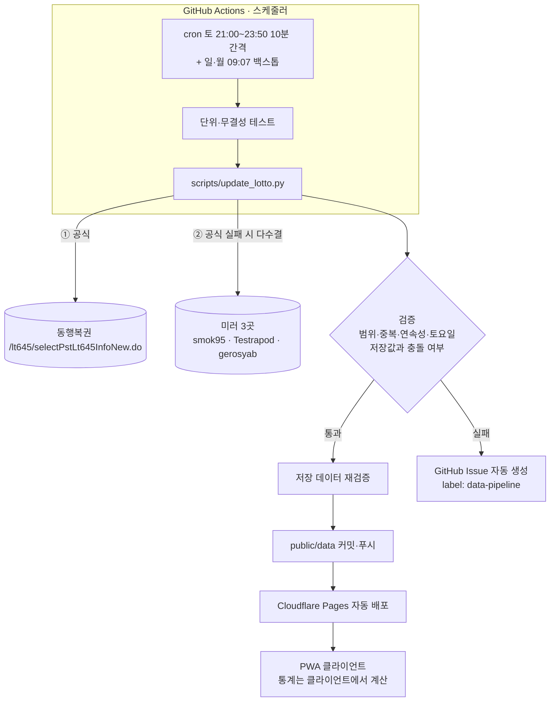
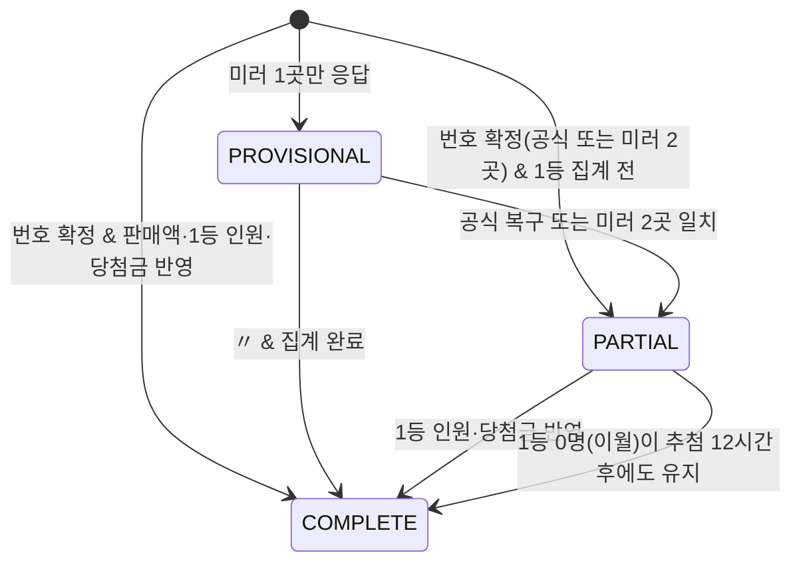

# 로또 6/45 QR 채점·1등 데이터 분석 플랫폼 제품 요구사항 정의서 (PRD)

| 항목 | 내용 |
| :--- | :--- |
| 문서 버전 | **v2.1** (v2.0 + 1~1,250회 데이터 구축 완료·수집 파이프라인 구현 반영) |
| 작성 기준일 | 2026년 11월 18일 (제1,250회 · 2026-11-14 추첨분까지 반영) |
| 제품 형태 | 모바일 퍼스트 반응형 웹앱(PWA) + 서버리스 주간 데이터 수집 파이프라인 |
| 핵심 한 줄 | **종이 로또의 QR을 찍으면 바로 채점되고, 내 기록이 자동으로 쌓여 “나의 적중률”을 재미있게 보여주는 무료·무가입 서비스** |

> **고지 원칙**: 로또 1등 확률은 매 회차 1/8,145,060으로 고정된 독립시행이다. 본 서비스의 통계·점수·생성기는 당첨 확률을 높이지 않으며 과거 데이터 탐색과 재미를 위한 것이다. 이 문구는 생성기·통계·리포트 화면과 푸터에 항상 노출한다.

---

## 0. v1.0 대비 변경 요약

| 구분 | v1.0 | v2.0 결정 | 이유 |
| :--- | :--- | :--- | :--- |
| 분석 대상 데이터 | 1~5등 당첨금·ROI | **1등 데이터만 수집·분석**(당첨자 수, 1인당·총 당첨금, 판매액, 자동/수동 구분). 2~5등 당첨금은 수집하지 않음 | 2·3등 회차별 당첨금은 원천 API에 없어 수집 비용이 크고 핵심 가치와 무관함 |
| 등수 판정 | 당첨금까지 계산 | 등수(1~5등)는 **번호·보너스만으로 판정**. 금액은 1등(실제 금액)과 4·5등(고정 5만/5천 원)만 표시하고, 2·3등은 “동행복권에서 금액 확인” 링크 | 보너스 번호는 2등 판정에 필요하므로 수집은 유지함 |
| 핵심 기능 | 번호 생성·백테스트 중심 | **QR 스캔 → 자동 채점 → 자동 저장 → 나의 적중률 리포트**가 핵심 루프. 생성기는 보조 기능(P1) | 실사용자는 주로 휴대폰으로 종이 복권을 확인함 |
| 데이터 소스 | 동행복권 구 API 단일 | **개편 후 공식 JSON(1순위) + 독립 미러 3곳 다수결 폴백**(§9). **1~1,250회 전체를 3곳 교차검증으로 구축 완료**(§9.0) | 구 API는 해외 IP 차단 보고. 새 엔드포인트는 GitHub Actions에서 동작 확인 |
| 수집 일정 | cron 2회, SLA 99.9% | 토요일 21:00~23:50 10분 간격 + 일·월 백스톱, **번호 SLA(토 23:00) 95% / 확정 SLA(일 12:00) 99%** | GitHub 스케줄 지연·누락을 감안함 |
| 사전 연산 | `stats_summary.json` 서버 연산 | **폐지**. 원본 `draws.json` 하나만 배포하고 통계는 클라이언트에서 계산 | 1,250회×45개 번호 연산은 수 ms 수준. 데이터 출처를 하나로 유지 |
| 백엔드 의존 기능 | 소셜 로그인 동기화, Web Push, 전체 성적 공시 | **MVP에서 제외**(로드맵 P2로 이동). 대안으로 `.ics` 캘린더 알림 제공 | “무가입·서버리스” 원칙과 충돌 |
| 용어 | 연속 “쌍/3연속” 혼용 | 부록 B에 **용어를 정의**(연속쌍 수, 최장 연속 길이 등) | 필터·점수 명세가 서로 어긋나는 문제 해결 |

---

## 1. 배경 및 문제 정의

1. **유료 예측 서비스 불신**: 2019~2023년 5년간 로또 예측 서비스 관련 한국소비자원 피해구제 신청은 **1,917건**이며, 처리불능 비율이 41.1%에 달한다([라이센스뉴스](https://www.lcnews.co.kr/news/articleView.html?idxno=76227), [한겨레](https://www.hani.co.kr/arti/economy/consumer/1142498.html)).
2. **종이 복권 확인 경험의 단절**: 판매점에서 산 종이 복권은 QR로 확인하면 동행복권 모바일 페이지가 열리고 끝난다. **기록이 남지 않아** “내가 지금까지 얼마나 맞혔는지”를 알 방법이 없다.
3. **통계 사이트의 모바일 사용성 문제**: 기존 무료 사이트는 한 화면에 수십 개 표를 나열해 휴대폰에서 쓰기 어렵고, 보너스 포함/제외 기준도 섞여 있다.

**해결 방향**: “찍으면 끝”인 채점 경험에 **자동 기록**과 **나의 적중률 리포트**라는 재미 요소를 더해 매주 토요일에 다시 찾아올 이유를 만든다. 통계는 **1등 데이터**(당첨자 수, 당첨금, 인기 패턴)에 집중해 차별화한다.

---

## 2. 제품 원칙

1. **모바일 퍼스트, 한 손 조작**: 핵심 동작(스캔)은 홈에서 탭 한 번으로 시작해 엄지 영역 안에서 끝난다.
2. **무가입·로컬 우선**: 모든 개인 기록은 브라우저(IndexedDB)에만 저장한다. 서버로 번호를 전송하지 않는다.
3. **자동이 기본**: 스캔하면 저장 버튼 없이 바로 저장되고(되돌리기 제공), 추첨 후 앱을 열면 바로 채점된다.
4. **정직한 확률**: 모든 재미 지표는 이론 확률과 나란히 보여주고, “과거는 미래에 영향을 주지 않는다”를 함께 표기한다.
5. **1등 데이터 집중**: 수집과 분석은 1등 지표에 한정해 파이프라인을 단순하게 유지한다.

---

## 3. 범위 (Scope)

| In Scope (v2.0) | Out of Scope (차기 검토) |
| :--- | :--- |
| QR 스캔 채점·자동 저장, 수동 번호 입력 | 회원가입·소셜 로그인·기기 간 동기화 |
| 나의 기록, 나의 적중률 리포트, 배지, 공유 카드 | Web Push 알림(서버 필요) → `.ics` 캘린더 알림으로 대체 |
| 1등 데이터 통계(빈도, 당첨자 수 추이, 인기도 지수, 자동/수동 비율) | 2~5등 당첨금·당첨자 수 수집 |
| 번호 생성기(필터) + 역대 대조 + 희소성 점수(추정) | 사이트 전체 생성 조합 성적 공시(서버 집계 필요) |
| 세후 실수령액 계산기(1등 기준) | 연금복권 등 다른 복권 |
| 주간 자동 데이터 수집(다중 소스·검증·알림) | 복권 구매 대행(법적 금지) |

---

## 4. 타깃 사용자 페르소나

| 우선순위 | 페르소나 | 행동 특성·니즈 | 핵심 기능 |
| :--- | :--- | :--- | :--- |
| **1순위** | **종이 구매 주간 확인자**<br>(전 연령, 판매점에서 자동 위주로 구매) | 토요일 밤이나 일요일에 지갑 속 복권을 꺼내 휴대폰으로 확인함. 매번 번호를 하나하나 대조하기 귀찮고, 몇 주 지나면 뭘 샀는지 잊어버림 | QR 스캔 → 즉시 채점, 자동 기록, 이번 주 결과 카드, 추첨 대기 티켓 자동 채점 |
| 2순위 | **재미 추구형 기록가**<br>(20~40대) | “내가 남들보다 운이 좋은지” 궁금하고, 결과를 친구와 공유하는 걸 즐김 | 나의 적중률·운 백분위, 배지, 자동 vs 수동 대결, 공유 카드 |
| 3순위 | **데이터 탐색형 분석가**<br>(30~50대, 수동·반자동) | 번호 빈도, 1등 당첨자 수 패턴을 직접 대조하며 번호를 고름 | 1등 통계, 인기도 지수, 생성기 필터, 역대 대조, 희소성 점수 |

---

## 5. 정보 구조 (모바일)

하단 탭 바 5칸이며, 가운데 스캔 버튼을 가장 크게 둔다.

```
[ 홈 ]  [ 통계 ]  [ ◉ 스캔 ]  [ 번호생성 ]  [ 내 기록 ]
```

| 화면 | 주요 구성 |
| :--- | :--- |
| **홈** | 최신 회차 당첨번호 카드(1등 인원·1인당 당첨금), 다음 추첨 카운트다운, **이번 주 내 티켓 요약**(대기 N장 / 결과 보기), 큰 “QR 찍기” 버튼, 지난주 내 결과 한 줄 |
| **스캔** | 전체 화면 카메라, 가이드 프레임, 연속 스캔 토글, 갤러리 이미지 불러오기, QR 링크 붙여넣기, 수동 입력 |
| **스캔 결과 시트** | 회차·게임 A~E별 번호 볼(일치 볼 강조), 등수 배지, 확률 한 줄(“3개 일치, 확률 2.24%”), 되돌리기 토스트 |
| **내 기록** | 회차별 티켓 타임라인(대기/채점 완료), 필터(등수·자동/수동), **나의 적중률 리포트**, 배지함, 백업/복원 |
| **통계** | 보너스 포함/제외 토글, 구간 탭(전체/100/50/15회), 번호 빈도 히트맵, 미출현 회차, **1등 분석**(당첨자 수·당첨금 추이, 인기도 지수, 자동/수동 비율), 실수령액 계산기 |
| **번호생성** | 고정수·제외수 볼 그리드, 필터 슬라이더, 5세트 생성, 희소성 등급, 역대 대조, 내 기록에 저장 |

---

## 6. 사용자 워크플로

### 6.1 핵심 루프



### 6.2 Flow A — QR 스캔 → 자연스러운 채점·자동 저장 (P0)

1. 사용자가 홈의 **“QR 찍기”**(또는 탭 바 가운데 버튼)를 누른다.
2. 처음 사용할 때만 카메라 권한 안내 화면(“QR 확인에만 사용하며 영상은 저장하지 않습니다”)을 보여준 뒤 권한을 요청한다.
3. 카메라 화면에서 QR이 인식되면 **진동(지원 기기)과 효과음**으로 알리고 300ms 안에 결과 시트를 띄운다.
4. QR을 해석한다(§7): 회차, 게임 A~E, 게임별 자동/수동/반자동 구분을 얻는다.
5. 결과 판정:
   - **추첨이 끝난 회차이고 데이터가 있음** → 게임별 일치 개수와 등수를 즉시 표시한다. 맞은 볼은 색을 채우고 나머지는 흐리게, 보너스 일치는 별도 테두리로 보여준다.
   - **아직 추첨 전인 회차** → “제1,251회 · 11/21(토) 20:35 추첨 · 2일 3시간 남음” 표시와 함께 **추첨 대기** 상태로 저장한다. [캘린더에 알림 추가] 버튼(.ics)을 제공한다.
   - **추첨은 끝났지만 데이터 집계 중**(파이프라인 반영 전) → “결과 반영 중이에요. 잠시 후 자동 채점됩니다” 안내와 [동행복권에서 바로 확인] 링크를 보여준다. 클라이언트 폴백 소스 조회(§9.8)를 시도한다.
6. **자동 저장**: 결과 시트가 뜨는 순간 내 기록에 저장되고, 하단에 “저장됨 · 되돌리기(5초)” 토스트가 뜬다.
7. **중복 방지**: 같은 QR을 다시 찍으면 새로 저장하지 않고 “이미 저장된 티켓이에요”와 함께 기존 결과를 보여준다.
8. 결과 연출:
   - 5등 이상: 등수별 축하 애니메이션. 1등은 실제 1인당 당첨금과 세후 실수령액, 4·5등은 고정 금액, 2·3등은 “당첨금은 동행복권에서 확인” 링크를 표시한다.
   - 미당첨: 재미 문구와 확률 한 줄(예: “2개 일치! 6명 중 1명꼴로 나오는 결과예요(15.1%)”).
9. **연속 스캔 모드**: 여러 장을 연달아 찍으면 각 장의 결과가 카드 스택으로 쌓이고, 마지막에 **“이번 주 총 N게임 · 최고 4등”** 요약을 보여준다.

### 6.3 Flow B — 추첨 후 자동 채점 (P0)

1. 토요일 추첨 후 앱을 열면(또는 PWA가 다시 포커스를 얻으면) `latest.json`을 확인한다(네트워크 우선, 실패 시 캐시).
2. 새 회차가 반영되었으면 **추첨 대기** 상태인 해당 회차 티켓을 모두 채점한다.
3. 결과 모달 “제1,251회 결과가 나왔어요: 3장 15게임 중 5등 2개”를 띄우고 내 기록의 해당 회차로 이동시킨다.
4. 해당 회차 데이터 상태가 `PROVISIONAL`(비공식 단일 출처, §9.5)이면 결과에 “잠정” 배지를 붙이고, 공식 소스로 확정되면 배지를 자동으로 없앤다.

### 6.4 Flow C — 나의 적중률 리포트 (P0 기본 / P1 확장)

1. 내 기록 → **“나의 적중률”** 카드를 누른다.
2. 채점 완료 게임이 10게임 미만이면 “10게임부터 정확한 리포트를 보여드려요”와 함께 현재 값만 보여준다.
3. 리포트 구성은 §8.2를 따른다(운 지수, 운 백분위, 일치 분포 vs 이론, 등수별 횟수, 나의 행운 번호, 자동 vs 수동 대결, 회수율).
4. [공유 카드 만들기] → 개인정보 없이 요약 이미지(Canvas)를 생성하고 Web Share API로 공유한다.

### 6.5 Flow D — 통계 탐색 → 번호 생성 → 보관 (P1)

1. 통계 탭에서 보너스 포함/제외와 구간을 정하고 빈도와 1등 분석을 살펴본다.
2. 번호생성 탭에서 고정수, 제외수, 필터를 설정하고 [5세트 생성]을 누른다.
3. 세트마다 희소성 등급(추정)과 **역대 대조**(1~1,250회 중 일치 개수별 횟수, 1등 일치 시 해당 회차 실제 당첨금)를 보여준다.
4. [내 기록에 저장]을 누르면 `source=generated`, 대상 회차 = 다음 회차로 저장하고 추첨 후 자동 채점한다(Flow B와 동일).
5. 생성 번호와 실제 구매 티켓은 리포트에서 **분리 집계**한다(기본값은 “실제 구매만”).

### 6.6 예외 시나리오

| 상황 | 처리 |
| :--- | :--- |
| 카메라 권한 거부 / 미지원 브라우저 | 안내 후 **갤러리 사진 불러오기**(`<input type=file accept=image/* capture=environment>`), **QR 링크 붙여넣기**, **수동 입력**을 제공 |
| 로또 6/45가 아닌 QR(연금복권, 일반 URL) | “로또 6/45 QR이 아니에요” + 수동 입력 유도. 다른 사이트 URL은 열지 않음 |
| QR 형식 해석 실패 | 원문을 저장하지 않고 오류 코드만 익명 이벤트로 기록. 수동 입력 유도 |
| 너무 오래된 회차 | 정상 채점(전 회차 데이터 보유) |
| 미래 회차가 2주 이상 앞섬 | 비정상 QR 가능성을 경고하고 저장은 허용 |
| 오프라인 | 대기 티켓으로 저장하고, 온라인 복귀 시 채점 |
| 되돌리기 | 5초 안에 누르면 저장을 취소. 이후에는 기록 상세에서 삭제 |
| 저장 공간 축출 위험(iOS) | 두 번째 스캔 후 “홈 화면에 추가” 안내와 `navigator.storage.persist()` 요청, 월 1회 백업 리마인드(§11) |

---

## 7. QR 코드 명세

### 7.1 형식

로또 6/45 종이 복권 QR은 동행복권 모바일 URL에 구매 정보를 담은 `v` 파라미터로 구성된다. 오픈소스 파서 2종([smok95/barcode_info](https://github.com/smok95/barcode_info), [bestevan01/Lotto-Utility](https://github.com/bestevan01/Lotto-Utility))의 구현을 기준으로 정리했으며, **실물 복권 검증은 Phase 0 PoC에서 수행**한다(§14).

```
http://m.dhlottery.co.kr/?v=0936m041720353943q071215303244m071113171829q010222253142m0414182731421050908394
                           └┬─┘└──── 게임 블록 × 최대 5 ────────────────────────────────────┘└───┬────┘
                         회차 4자리   [유형 1글자][번호 2자리 × 6]                              TR 10자리
```

| 요소 | 길이 | 내용 |
| :--- | :--- | :--- |
| 호스트 | – | `m.dhlottery.co.kr`(현행), `qr.nlotto.co.kr`, `qr.645lotto.net`(구 사업자 시절 형식) |
| 회차 | 4자리 | `0936` → 제936회 |
| 게임 블록 | 13자 × 1~5 | 첫 글자가 유형: `q`=자동, `m`=수동, `s`=반자동, `n`=미사용(건너뜀). 이어서 번호 2자리 × 6개 |
| TR 번호 | 10자리 | 티켓 일련번호. **원문을 저장하지 않음**(아래 개인정보 항목 참고) |

- **슬롯 매핑**: 블록 순서대로 A~E로 표시한다(`n` 블록도 순서는 차지함).
- **개인정보·보안**: QR 원문(`v`)은 기기에도 저장하지 않는다. 대신 `SHA-256(v)` 해시를 `ticketKey`로 저장해 중복을 판정한다. 공유 카드와 분석 이벤트에도 번호와 TR을 넣지 않는다.

### 7.2 인식 엔진

| 환경 | 엔진 |
| :--- | :--- |
| Android Chrome | `BarcodeDetector`(네이티브) 우선 |
| iOS Safari, 기타 | **ZXing WASM**(`zxing-wasm`) 또는 `qr-scanner`. 스캔 화면에 들어갈 때 지연 로드 |
| 공통 | `getUserMedia({ video: { facingMode: 'environment' } })`, HTTPS 필수, 초당 10~15프레임 디코딩, 손떨림 대비 동일 결과 2프레임 연속 시 확정 |

### 7.3 파서 레퍼런스 (TypeScript, 단위 테스트 통과 로직)

```ts
const GAME_TYPE = { q: 'auto', m: 'manual', s: 'semi' } as const;
type GameType = (typeof GAME_TYPE)[keyof typeof GAME_TYPE];
const HOST_RE = /(^|\.)(dhlottery\.co\.kr|nlotto\.co\.kr|645lotto\.net)$/;

export class QrError extends Error {
  constructor(public code: 'NOT_LOTTO' | 'BAD_FORMAT' | 'BAD_NUMBERS' | 'NO_GAMES', msg: string) { super(msg); }
}

export function parseLottoQr(raw: string) {
  const text = raw.trim();
  let v: string | null;
  try {
    const url = new URL(text);
    if (!HOST_RE.test(url.hostname)) throw new QrError('NOT_LOTTO', '로또 6/45 QR이 아닙니다');
    v = url.searchParams.get('v');
  } catch (e) {
    if (e instanceof QrError) throw e;
    v = text; // URL이 아니면 v 값만 붙여넣은 경우로 간주
  }
  const m = /^(\d{4})((?:[a-z]\d{12}){1,5})(\d{0,20})$/.exec(v ?? '');
  if (!m) throw new QrError('BAD_FORMAT', 'QR 형식을 해석할 수 없습니다');

  const games: { slot: string; type: GameType; nums: number[] }[] = [];
  for (const [i, block] of m[2].match(/[a-z]\d{12}/g)!.entries()) {
    const type = GAME_TYPE[block[0] as keyof typeof GAME_TYPE];
    if (!type) continue; // n(미사용) 등 알 수 없는 블록은 건너뜀
    const nums = block.slice(1).match(/\d{2}/g)!.map(Number).sort((a, b) => a - b);
    if (nums.some(n => n < 1 || n > 45) || new Set(nums).size !== 6)
      throw new QrError('BAD_NUMBERS', '번호 범위가 올바르지 않습니다');
    games.push({ slot: 'ABCDE'[i], type, nums });
  }
  if (games.length === 0) throw new QrError('NO_GAMES', '유효한 게임이 없습니다');
  return { round: Number(m[1]), games, v: v! }; // v는 해시 계산 후 즉시 폐기
}

/** 등수 판정: 일치 개수는 본번호 6개 기준, 보너스는 2등 판정에만 사용 */
export function grade(nums: number[], draw: { nums: number[]; bonus: number }) {
  const matched = nums.filter(n => draw.nums.includes(n)).length;
  const bonusHit = nums.includes(draw.bonus);
  const rank = matched === 6 ? 1 : matched === 5 && bonusHit ? 2 : matched === 5 ? 3
             : matched === 4 ? 4 : matched === 3 ? 5 : null;
  return { matched, bonusHit, rank };
}
```

검증한 케이스: 위 예시 URL에서 제936회 5게임(수동·자동 혼합)을 정확히 해석함, `n` 블록 건너뛰기, 외부 URL 거부(`NOT_LOTTO`), 형식 오류(`BAD_FORMAT`), 46 이상 번호 거부(`BAD_NUMBERS`), 5개 일치 + 보너스 → 2등.

---

## 8. 나의 기록 & 나의 적중률

### 8.1 로컬 데이터 모델 (IndexedDB, Dexie)

| 스토어 | 주요 필드 | 비고 |
| :--- | :--- | :--- |
| `tickets` | `id`, `source`(`qr`·`manual`·`generated`), `round`, `ticketKey`(QR 해시, unique), `purchasedAt?`, `createdAt`, `memo?` | 1장 = 최대 5게임 |
| `games` | `id`, `ticketId`, `round`, `slot`(A~E), `type`(`auto`·`manual`·`semi`·`generated`), `nums[6]`, `result?{matched, bonusHit, rank, gradedAt, provisional}` | `result`가 비어 있으면 추첨 대기 |
| `achievements` | `id`, `unlockedAt`, `round` | 배지 |
| `meta` | `schemaVersion`, `lastBackupAt`, `persistGranted` | 마이그레이션·백업 리마인드 |

- **비용**: 1게임 1,000원으로 계산한다(티켓 단위 합산).
- **백업/복원**: JSON 내보내기·가져오기(`ticketKey`로 중복 병합)를 지원한다. 파일 공유 시트로 메신저나 드라이브에 저장할 수 있다.

### 8.2 “나의 적중률” 지표 정의

| 지표 | 정의 | 이론값(무작위 기준) |
| :--- | :--- | :--- |
| **번호 적중률** | Σ일치 개수 ÷ (6 × 채점 게임 수) | **13.33%** (6/45) |
| **평균 일치 개수** | Σ일치 개수 ÷ 채점 게임 수 | **0.80개** |
| **당첨 게임 비율** | 5등 이상 게임 ÷ 채점 게임 수 | **2.38%** (약 1/42) |
| **운 지수** | 평균 일치 개수 ÷ 0.8 × 100 | 100 = 딱 평균 |
| **운 백분위** | 같은 게임 수를 무작위로 샀을 때 내 총 일치 개수 이상이 나올 확률 → “상위 X%” | 50% 부근이 정상 |
| **일치 분포** | 0~6개 일치 게임 수 막대(나) vs 이론 분포(점선) | 부록 A |
| **등수별 횟수** | 1~5등 횟수, 최근 당첨 회차 | – |
| **나의 행운 번호 TOP 3** | 내가 고른 번호 중 실제로 가장 많이 맞은 번호 | – |
| **자동 vs 수동 대결** | 유형별 평균 일치 개수·당첨 비율 비교 | 둘 다 0.80 (이론상 차이 없음을 함께 표기) |
| **회수율** | 확인된 당첨금 ÷ 누적 구매액. 1등은 실제 금액, 4·5등은 고정액, 2·3등은 “금액 미집계” 표기 | 로또 전체 환급률 약 50% |
| **아깝다 기록** | 5개 일치·2등 미달, 4개 일치 등 “최고 근접” 기록 | – |

**운 백분위 계산**: 게임 1개의 일치 개수는 초기하분포 H(45, 6, 6)를 따른다(평균 0.8, 분산 0.6145). N게임 합의 분포는 500게임 이하이면 **정확한 합성곱**으로, 초과하면 **정규근사(연속성 보정)**로 계산한다(500게임 정확 계산 36ms, Web Worker에서 실행).

```ts
const P = [3262623, 3454542, 1233765, 182780, 11115, 234, 1].map(c => c / 8145060);
export function luckPercentile(totalMatched: number, games: number): number {
  if (games > 500) {
    const mu = 0.8 * games, sd = Math.sqrt(0.6145454545 * games);
    return 1 - normalCdf((totalMatched - 0.5 - mu) / sd);
  }
  let dist = [1];
  for (let g = 0; g < games; g++) {
    const next = new Array(dist.length + 6).fill(0);
    dist.forEach((p, s) => { if (p) P.forEach((q, k) => { next[s + k] += p * q; }); });
    dist = next;
  }
  return dist.slice(totalMatched).reduce((a, b) => a + b, 0); // P(S ≥ 관측값)
}
```

**문구 예시**: “지금까지 120게임, 평균 0.93개 일치. 운 지수 116! 무작위로 120게임을 산 사람 중 **상위 9%**의 운이에요. (단, 다음 주 확률은 똑같이 1/8,145,060)”

### 8.3 배지(업적) 예시

| 배지 | 조건 | 배지 | 조건 |
| :--- | :--- | :--- | :--- |
| 첫 발자국 | 첫 QR 스캔 | 5등 데뷔 | 첫 5등 |
| 개근상 | 4주 연속 스캔 | 아깝다! | 5개 일치(2·3등 포함) |
| 100게임 클럽 | 채점 게임 100개 | 보너스의 장난 | 보너스 번호만 맞은 게임 |
| 운 상위 10% | 운 백분위 10% 이하(30게임 이상) | 자동 신봉자 / 수동 장인 | 유형별 50게임 이상 |
| 같은 번호 사랑 | 같은 조합을 4주 이상 연속 구매 | 데이터 수집가 | 백업 파일 내보내기 |

---

## 9. 데이터 자동수집 워크플로

### 9.0 데이터 구축 현황 (2026-11-18 기준, 구축 완료)

| 항목 | 상태 |
| :--- | :--- |
| 수록 범위 | **제1회(2002-12-07) ~ 제1,250회(2026-11-14), 1,250회 전체, 누락 0** |
| 파일 | `public/data/draws.json`(원본 287KB, gzip 38KB), `public/data/latest.json` |
| 교차검증 | 서로 독립적으로 수집된 공개 데이터셋 3곳(smok95, Testrapod, gerosyab)을 회차별로 대조. **번호 6개·보너스·추첨일·1등 인원·1등 1인당 당첨금·판매액이 1,250회 모두 3곳 일치** |
| 정합성 | 회차 연속성, 1~45 범위, 중복 없음, 보너스 중복 없음, 추첨일 토요일, 예상 추첨일(제1회부터 매주) 전부 통과. 휴회로 인한 날짜 예외 없음 |
| 외부 통계 대조 | 보너스 제외 1위 **34번 188회**, 보너스 포함 1위 **27번 217회**, 13·34번 212회(v1.0에 인용된 로또타파·시그널파이어·min-inter 수치와 정확히 일치). 제1,128회 1등 63명, 제1,000회·제1,250회 값 일치 |
| 1등 0명(이월) 회차 | 1, 4, 5, 7, 8, 9, 13, 18, 24, 41, 71, 289, 295, 463회(14회) |
| 1등 자동/수동 인원 | 제262회부터 보유(인원 합계가 1등 당첨자 수와 전 회차 일치). 제2~261회는 `firstType: null` |
| 재현 방법 | `python scripts/update_lotto.py --seed`(미러 3곳 내려받기 → 3곳 모두 일치해야 통과). 테스트: `python -m unittest discover -s scripts` |

### 9.1 데이터 소스 재조사 결과 (2026-11 기준)

| 소스 | 형태 | 제공 데이터 | GitHub Actions 접근 | 공식성 | 채택 역할 |
| :--- | :--- | :--- | :--- | :--- | :--- |
| **동행복권 개편 후 JSON**<br>`/lt645/selectPstLt645InfoNew.do?srchDir=center&srchLtEpsd={회차}`<br>`/lt645/selectPstLt645Info.do`(최신) | JSON `data.list[]`(문서화되지 않은 내부 엔드포인트). 필드: `ltEpsd`, `ltRflYmd`, `tm1~6WnNo`, `bnsWnNo`, `rnk1WnNope`, `rnk1WnAmt`, `wholEpsdSumNtslAmt` | 번호·보너스·추첨일·1등 인원·1인당 당첨금·판매액 | **가능**: [Testrapod/lottoworld](https://github.com/Testrapod/lottoworld)가 이 엔드포인트로 2026-10~11월 예약 실행 8회 모두 성공 | 공식 원천 | **1순위** |
| 동행복권 구 JSON `common.do?method=getLottoNumber` | JSON | 동일 | 해외 IP 차단·302 리다이렉트 보고([hambakim/Note#2](https://github.com/hambakim/Note/pull/2)) | 공식(구) | **미사용**(개편 후 대체됨) |
| **smok95 공개 JSON**([smok95/lotto](https://github.com/smok95/lotto)) | GitHub Pages JSON(회차별·`latest`·`all`) | 위 항목 + **1등 자동/반자동/수동 인원** | 가능. 토 21:01경 갱신 | 비공식, 라이선스 미표기 | 2순위 미러 + 1등 자동/수동 보강 |
| **Testrapod 미러** | 공식 응답을 구 API 형식으로 저장한 JSON(raw.githubusercontent) | 번호·1등·판매액 | 가능. 일 02:00~03:00 KST 갱신 | 비공식(공식 응답 사본) | 미러 |
| **gerosyab 미러**([gerosyab/api](https://github.com/gerosyab/api)) | JSON `{keys, data}` | 번호·1등(판매액 없음) | 가능. 일 00:38 KST 갱신 | 비공식 | 미러 |
| 공공데이터포털 | – | 당첨번호 API **없음**(1등 판매점 파일만 있음, [data.go.kr](https://www.data.go.kr/data/15059963/fileData.do)) | – | 공식 | 미사용 |

**결론**
- 공식 공개 API는 없다. 개편된 동행복권 내부 JSON은 해외 러너에서도 동작하는 것이 확인되어 1순위로 쓴다.
- 공식 소스가 막히면 **미러 3곳의 다수결(2곳 이상 일치)**로 확정한다.
- 미러가 1곳만 응답하면 `PROVISIONAL`로 표시한다.

### 9.2 아키텍처



### 9.3 국내 릴레이 (비상용, 현재 불필요)

- 공식 엔드포인트가 해외 IP를 다시 막을 경우를 대비한다. 서울 리전 AWS Lambda 같은 국내 프록시를 띄운다.
- GitHub Secret `LOTTO_OFFICIAL_BASE`에 릴레이 주소만 넣으면 ETL이 그 주소로 `/lt645/...` 경로를 호출한다. 코드 변경은 필요 없다.
- 릴레이는 `/lt645/selectPstLt645InfoNew.do`만 허용하고 리다이렉트를 따라가지 않으며 토큰 인증을 둔다.

### 9.4 데이터 스키마 (1등 데이터 전용)

`public/data/draws.json`: 회차 오름차순 배열, 한 줄에 한 회차(git diff 가독성).

```json
{"no":1250,"date":"2026-11-14","nums":[1,5,18,23,27,28],"bonus":8,"first":{"winners":9,"prize":3103164459},"sales":116731227000,"firstType":{"auto":9,"semi":0,"manual":0},"status":"COMPLETE","source":"seed:gerosyab+smok95+testrapod"}
```

| 필드 | 설명 |
| :--- | :--- |
| `nums`, `bonus` | 본번호 6개(오름차순), 보너스 번호(2등 판정용) |
| `first.winners / prize` | 1등 당첨자 수 / 1인당 당첨금(원). 1등 총액은 `winners × prize`로 클라이언트에서 계산 |
| `sales` | 총 판매액(원). 인기도 지수 분모(판매 게임 수 = `sales / 1000`) |
| `firstType` | 1등 자동·반자동·수동 인원(정보가 없으면 `null`) |
| `status` | `COMPLETE` / `PARTIAL` / `PROVISIONAL`(§9.5) |
| `source` | `dhlottery`(공식), `mirror:a+b`(미러 다수결), `seed:…`(초기 3곳 교차검증) |

`public/data/latest.json`: 홈 첫 화면용 경량 파일(`latest`, `count`, `nextRound`, `nextDrawAt`, `updatedAt`).

### 9.5 상태 전이 규칙



- 미확정 회차는 실행마다 최신순으로 최대 30건까지 다시 수집한다.
- `PARTIAL` 이상인 회차의 번호가 새 수집과 다르면 **중단하고 수동 검토**한다(정정 감지).
- 공식 값과 미러 값이 다르면 공식 값을 쓰고 경고를 남긴다.
- 미러끼리 동률로 불일치하면 중단한다.
- 한 번 실패한 소스는 그 실행 안에서 다시 호출하지 않는다(서킷 브레이커).

### 9.6 주간 스케줄 (KST, cron은 UTC)

| 단계 | 시각 (KST) | cron (UTC) | 작업 |
| :--- | :--- | :--- | :--- |
| Stage 0. 초기 시드 | **완료**(2026-11-18) | – | §9.0 참고. 재구축이 필요하면 `workflow_dispatch`에서 `seed=true` |
| Stage 1. 속보 수집 | 토 21:00 ~ 23:50, **10분 간격** | `*/10 12-14 * * 6` | 공식 엔드포인트 조회 → 번호 반영(`PARTIAL`/`COMPLETE`). 이미 확정이면 수 초 만에 종료(멱등, 변경 없으면 커밋 없음) |
| Stage 2. 백스톱 ① | 일 09:07 | `7 0 * * 0` | 미확정 재수집. 이 시각에는 미러 3곳도 모두 갱신된 상태라 공식 장애 시에도 다수결 확정 가능 |
| Stage 3. 백스톱 ② | 월 09:07 | `7 0 * * 1` | 최종 재시도. **추첨 후 36시간이 지나도 미확정이면 exit 1 → Issue 알림** |
| Stage 4. 검증 | 수집 직후 | – | 실행 전 단위·무결성 테스트, 수집 후 저장 데이터 재검증(1회부터 연속, 알려진 회차 값, 외부 통계 일치). **재검증을 통과한 경우에만 커밋** |
| Stage 5. 배포 | 변경이 있을 때만 | – | `public/data/*` 커밋(`pull --rebase` 후 push) → Cloudflare Pages 자동 배포 |

> GitHub 스케줄은 혼잡 시 지연이 크다. 참고 사례인 Testrapod는 21:17 예약 실행의 커밋이 수 시간 뒤에 기록되었다. 10분 간격 다중 실행과 백스톱으로 보완한다. **예약 실행은 기본 브랜치(main)에 있을 때만 동작**한다.

### 9.7 GitHub Actions 워크플로

구현 파일: [`.github/workflows/update_lotto_data.yml`](../.github/workflows/update_lotto_data.yml)

| 스텝 | 조건 | 내용 |
| :--- | :--- | :--- |
| Unit & data integrity tests | 항상(PR 포함) | `python -m unittest discover -s scripts`(13개 테스트) |
| Run ETL | PR 제외 | `scripts/update_lotto.py`(수동 실행에서 `seed=true`면 `--seed`) |
| Re-check data | ETL이 실행된 경우(SLA 실패 포함) | 저장 데이터 무결성 재검증 |
| Commit & push | 재검증 성공 시에만 | 변경이 있을 때만 커밋 |
| Open issue | 예약 실행 실패 시 | `data-pipeline` 라벨 이슈 생성(열린 이슈가 있으면 생략) |

**ETL 종료 코드**: `0` 정상(추첨 전이라 아직 데이터가 없는 경우 포함), `1` SLA 위반(수집분은 커밋), `2` 검증 실패(데이터 미반영).

### 9.8 클라이언트 데이터 로딩

1. 앱 셸과 `draws.json`은 Service Worker로 캐시한다(파일명 해시 또는 ETag로 갱신).
2. `latest.json`은 **네트워크 우선**(`no-cache`)으로 받는다. 토요일 20:35 이후 `nextRound`가 아직 반영되지 않았으면 5분 간격으로 재확인한다(앱이 화면에 있을 때만).
3. **클라이언트 폴백**: 추첨 후 60분이 지나도 반영되지 않았으면 smok95 `latest.json`을 직접 조회한다(GitHub Pages CORS 허용 여부는 PoC에서 확인). 조회 결과는 `PROVISIONAL`로 채점하고 “잠정” 배지를 붙인다.
4. 통계(빈도, 미출현, 동반출현, 1등 지표)는 Web Worker에서 계산해 메모이즈한다. 1,250회 기준 10ms 미만이 목표다.

---

## 10. 기능 요구사항 (Functional Requirements)

| ID | 모듈 | 기능 | 수용 기준 (Acceptance Criteria) | 우선순위 |
| :--- | :--- | :--- | :--- | :--- |
| **FR-01** | 스캔 | QR 스캔 채점 | • 홈에서 탭 1회로 카메라 진입<br>• QR이 보이면 300ms 안에 결과 시트 표시(중급 안드로이드·iPhone 기준)<br>• 게임 A~E별 일치 볼 강조, 등수, 자동/수동 유형 표시<br>• 추첨 전 회차는 대기 상태와 카운트다운 표시<br>• 6.6의 예외를 모두 처리 | **P0** |
| **FR-02** | 스캔 | 자동 저장·중복 방지 | • 결과 표시와 동시에 저장, 5초 되돌리기<br>• `SHA-256(v)`로 중복 판정, QR 원문 미저장 | **P0** |
| **FR-03** | 스캔 | 대체 입력 | • 갤러리 이미지 디코딩, QR 링크 붙여넣기, 볼 그리드 수동 입력(1~5게임) | **P0** |
| **FR-04** | 기록 | 추첨 후 자동 채점 | • 앱 진입·포커스 시 새 회차가 있으면 대기 티켓 전체 채점 후 결과 모달<br>• `PROVISIONAL` 데이터 채점은 “잠정” 표시, 확정 시 자동 갱신 | **P0** |
| **FR-05** | 기록 | 내 기록 타임라인 | • 회차별 그룹, 대기/채점 완료 구분, 등수·유형 필터, 메모, 삭제 | **P0** |
| **FR-06** | 리포트 | 나의 적중률 기본 | • §8.2의 번호 적중률, 평균 일치, 일치 분포 vs 이론, 등수별 횟수, 운 지수, 운 백분위<br>• 실제 구매와 생성 번호 분리 집계 | **P0** |
| **FR-07** | 데이터 | 홈 최신 회차 카드 | • 당첨번호·보너스, 1등 인원·1인당 당첨금, 다음 추첨 카운트다운(토 20:00 판매 마감 / 20:35 추첨) | **P0** |
| **FR-08** | 파이프라인 | 주간 자동수집 | • §9 전체 구현, 소스 폴백·교차검증·상태 전이·Issue 알림<br>• 번호 반영: 토 23:00 KST까지 95%, 1등 확정: 일 12:00 KST까지 99% | **P0** |
| **FR-09** | 리포트 | 재미 확장 | • 배지(§8.3), 나의 행운 번호, 자동 vs 수동 대결, 회수율, 아깝다 기록, 공유 카드(Web Share, 번호 미포함 옵션) | **P1** |
| **FR-10** | 통계 | 번호 빈도·미출현 | • 보너스 포함/제외 전역 토글, 구간(전체/100/50/15회), 히트맵·순위, 연속 미출현 회차, 번호대(1~10/11~20/21~30/31~40/41~45) 비중<br>• **수용 기준: 자체 데이터로 계산한 값이 동행복권 공식 통계 페이지 값과 일치** | **P1** |
| **FR-11** | 통계 | 1등 분석 | • 1등 당첨자 수·1인당 당첨금 추이 차트, 역대 최다·최소 회차, 1등 0명 회차<br>• **인기도 지수** = 실제 1등 인원 ÷ 기대 인원(판매 게임 수 ÷ 8,145,060)<br>• 패턴별(생일수 개수, 연속 포함, 용지 같은 줄, 등차) 평균 인기도 지수와 표본 수, 95% 신뢰구간<br>• 1등 자동/반자동/수동 비율 추이 | **P1** |
| **FR-12** | 계산기 | 1등 세후 실수령액 | • (당첨금 − 구입비 1,000원)에 대해 3억 원 이하 22%, 3억 원 초과분 33%, 200만 원 이하 비과세 | **P1** |
| **FR-13** | 생성기 | 필터 번호 생성 | • 고정수 ≤ 5, 제외수 ≤ 35, 총합 구간(기본 91~180), 홀짝·고저 비율, 연속쌍 수 상한(기본 1), AC값 하한(기본 7)<br>• 5세트 50ms 안에 생성. 불가능하면 어떤 조건이 충돌하는지 안내하고 완화 방법을 제안(백트래킹 기반 생성, 단순 거절 샘플링 금지) | **P1** |
| **FR-14** | 생성기 | 역대 대조·희소성 점수 | • 1~최신 회차 일치 개수별 횟수, 1등 일치 시 해당 회차 실제 당첨금<br>• 희소성 등급 S/A/B/C(“추정” 표기, 감점 사유 툴팁). 감점 가중치는 FR-11 인기도 지수 분석으로 보정 | **P1** |
| **FR-15** | PWA | 설치·오프라인·알림 대체 | • 홈 화면 설치 유도(2번째 스캔 후), 오프라인 앱 셸, `.ics` 토요일 20:40 알림 일정 내려받기 | **P1** |
| **FR-16** | 기록 | 백업/복원 | • JSON 내보내기·가져오기(중복 병합), 30일마다 백업 리마인드 | **P1** |
| **FR-17** | 확장 | 서버 기능 | • Web Push(Cloudflare Workers + KV), 선택형 기기 간 동기화, 전체 사용자 익명 통계 | **P2** |

### 10.1 희소성 점수 초기 가중치 (FR-14, 추정 모델)

용지 좌표: 한 줄에 7칸(1~7, 8~14, …, 43~45). 행 = ⌈n/7⌉, 열 = ((n−1) mod 7) + 1.

| 감점 요소 | 초기 감점 | 근거 |
| :--- | :--- | :--- |
| 6개 모두 1~31(생일 범위) | −35 | 날짜 선택 편향 |
| 1~31이 5개 | −20 | 〃 |
| 등차수열·AC값 0~2 | −20 | 패턴 선택 편향 |
| 용지 같은 행·열·대각선에 4개 이상 | −15 | 용지 패턴 마킹 |
| 최장 연속 길이 3 이상 | −10 | 연속 마킹 |
| 직전 회차 번호 3개 이상 포함 | −10 | 지난주 번호 재사용 |
| 끝자리가 같은 번호 4개 이상 | −5 | 패턴 선택 |

100점에서 시작해 S ≥ 85, A ≥ 70, B ≥ 50, C < 50으로 등급을 매긴다. **1등 당첨 확률은 등급과 무관**하며, 이 점수는 “당첨 시 나눠 가질 사람이 적을 가능성”을 추정한 값임을 툴팁에 고지한다.

---

## 11. 비기능 요구사항

| 영역 | 요구사항 |
| :--- | :--- |
| 성능 | 4G 중급 기기에서 LCP 2.0초 이하. 초기 JS(gzip) 150KB 이하(스캐너 WASM은 지연 로드). `draws.json` 40KB(br/gzip) 이하. 통계 재계산 10ms 미만 |
| 스캔 | 인식 후 결과 표시까지 300ms 이하. 저조도·구김 대비 화면 밝기 안내, 플래시 토글(지원 기기) |
| 저장 지속성 | `navigator.storage.persist()` 요청. **iOS Safari는 7일간 사이트와 상호작용이 없으면 스크립트가 저장한 데이터를 삭제할 수 있으므로**, 홈 화면 설치(PWA는 예외)와 백업을 안내 |
| 오프라인 | 앱 셸·데이터 캐시. 오프라인에서 스캔하면 대기 티켓으로 저장 |
| 접근성 | 볼 색상(1~10 노랑, 11~20 파랑, 21~30 빨강, 31~40 회색, 41~45 초록)과 숫자 텍스트를 함께 표시해 색만으로 정보를 전달하지 않음. 명도 대비 4.5:1, 스크린리더 레이블, 축하 애니메이션은 `prefers-reduced-motion`을 따름 |
| 개인정보 | 번호·QR·기록은 기기에만 저장. 분석은 쿠키 없는 도구(Umami/Plausible 등)로 **이벤트 이름만** 수집(번호·회차·TR 제외). 카메라 영상 미저장 |
| 보안 | HTTPS 필수(카메라 API 요건), CSP 적용, 외부 스크립트 최소화. 비상용 릴레이 주소·토큰은 GitHub Secrets에 보관 |
| 호환성 | iOS Safari 16.4+, Android Chrome 최신 2개 버전, 삼성 인터넷 |

---

## 12. 법적·윤리적 컴플라이언스

1. **확률 고지**(상단 원칙 문구)를 생성기, 통계, 리포트, 푸터에 항상 노출한다. “당첨 확률 상승”, “AI 예측”, “1등 보장” 같은 표현은 금지한다.
2. **비공식 서비스 표기**: “동행복권과 무관한 비공식 서비스이며, 당첨 여부와 당첨금은 반드시 동행복권 공식 사이트 또는 판매점에서 확인하세요.” 동행복권 로고·상표는 쓰지 않는다.
3. **청소년 보호**: 19세 미만 복권 구매 불가 안내, 한국도박문제예방치유원 헬프라인 **1336** 링크를 푸터에 둔다.
4. **과몰입 방지**: 리포트에 누적 구매액을 항상 표시하고, 월 구매액이 사용자가 정한 한도를 넘으면 부드러운 안내를 보여준다(선택 기능, P1).
5. **데이터 수집 예절**: 원 서버 호출은 주 수십 회 이내로 제한하고, 요청 간격 0.3초 이상, 식별 가능한 User-Agent를 쓴다. 이용약관과 robots 정책은 출시 전에 검토한다. 미러 데이터(smok95, Testrapod, gerosyab)는 라이선스가 표기되어 있지 않으므로 출처를 표기하고 검증·폴백 용도로 한정한다. 당첨번호 자체는 사실 정보이며, 기준은 공식 소스다.
6. **구매 대행·중개 금지**: 복권 구매·결제 기능은 제공하지 않는다.

---

## 13. 핵심 성과 지표 (KPI)

| 지표 | 정의 | 목표 |
| :--- | :--- | :--- |
| 스캔 성공률 | 카메라 진입 세션 중 1회 이상 해석에 성공한 비율 | **90% 이상** |
| 스캔 소요 시간 | 카메라 진입 → 결과 시트 표시 중앙값 | **2초 이하** |
| 주간 재방문율 | 직전 7일 안에 티켓을 저장한 사용자 중 토 20:35 ~ 일 24:00 사이 재방문 비율 | **40% 이상** |
| 리포트 도달률 | 채점 10게임 이상 사용자 중 적중률 리포트를 연 비율 | 50% 이상 |
| 공유율 | 리포트를 연 사용자 중 공유 카드 생성 비율 | 10% 이상 |
| 파이프라인 SLA | 번호 반영 토 23:00 KST / 1등 확정 일 12:00 KST | 95% / 99% |

---

## 14. 출시 로드맵

| 단계 | 일정 | 범위 |
| :--- | :--- | :--- |
| **Phase 0: PoC** | D-7 ~ D0 | ① ~~데이터 소스 확보~~ **완료**: 1~1,250회 시드 구축, 새 공식 엔드포인트의 GitHub Actions 동작 사례 확인. 남은 일은 main 머지 후 첫 토요일 예약 실행 결과 확인<br>② 실물 복권 10장 이상(자동/수동/반자동, 1~5게임)으로 QR 형식 검증<br>③ iOS Safari·Android Chrome 카메라 인식률 측정<br>④ smok95 GitHub Pages의 CORS 허용 여부 확인(클라이언트 폴백용) |
| **Phase 1: MVP** | D+1 ~ D+2주 | FR-01~08: 데이터 파이프라인, 홈, QR 스캔·자동 저장·자동 채점, 내 기록, 적중률 기본 리포트 |
| **Phase 2: 재미·분석** | D+3 ~ D+4주 | FR-09~12, 15, 16: 배지·공유 카드, 번호 빈도 통계, 1등 분석(인기도 지수), 실수령액 계산기, PWA 설치·`.ics`, 백업/복원 |
| **Phase 3: 생성기** | D+5 ~ D+6주 | FR-13~14: 필터 생성기, 역대 대조, 희소성 점수(인기도 지수 기반 보정) |
| **차기** | 지표 확인 후 | FR-17(Web Push, 동기화, 익명 전체 통계) |

**권장 기술 스택**: Vite + React(또는 Preact) + TypeScript, `vite-plugin-pwa`, Dexie(IndexedDB), `zxing-wasm`, 차트는 경량 SVG 컴포넌트, 호스팅은 Cloudflare Pages, 데이터 파이프라인은 Python 3.12 표준 라이브러리.

---

## 15. 오픈 이슈

| # | 이슈 | 해결 방법 / 책임 단계 |
| :--- | :--- | :--- |
| 1 | 공식 엔드포인트가 다시 해외 IP를 막을 가능성 | 미러 다수결로 자동 대응 중. 장기간 막히면 국내 릴레이(`LOTTO_OFFICIAL_BASE`)를 투입 |
| 2 | QR 유형 문자(`q`/`m`/`s`/`n`) 의미와 1~4게임 티켓의 블록 구성 | 실물 복권으로 검증. 파서는 알 수 없는 문자를 건너뛰도록 이미 방어 처리 |
| 3 | 1등 집계 전에 공식 엔드포인트가 금액 0을 주는지, 해당 회차를 아예 빼고 주는지 | 첫 토요일 실행 로그로 확인. 두 경우 모두 상태 전이 규칙으로 처리됨 |
| 4 | 1등 자동/수동 구분 데이터의 공식 출처 | 현재는 smok95 값(1등 인원 합계 일치 검증됨). 공식 결과 페이지 파싱 추가 여부를 Phase 2에서 결정 |
| 5 | 휴회 등으로 추첨일이 예외적으로 바뀐 회차 존재 여부 | 시드 구축 시 예상 추첨일 경고 로그를 전수 검토 |

---

## 부록 A. 확률표 (6/45, 1게임)

| 일치 개수 | 경우의 수 | 확률 | 약 1/N | 등수 |
| :--- | ---: | ---: | ---: | :--- |
| 0 | 3,262,623 | 40.06% | 1/2.5 | – |
| 1 | 3,454,542 | 42.41% | 1/2.4 | – |
| 2 | 1,233,765 | 15.15% | 1/6.6 | – |
| 3 | 182,780 | 2.244% | 1/45 | 5등 |
| 4 | 11,115 | 0.1365% | 1/733 | 4등 |
| 5 (보너스 불일치) | 228 | 0.0028% | 1/35,724 | 3등 |
| 5 + 보너스 | 6 | 0.00007% | 1/1,357,510 | 2등 |
| 6 | 1 | 0.0000123% | 1/8,145,060 | 1등 |

- 5등 이상 당첨 확률: 194,130 / 8,145,060 = **2.383%(약 1/42)**
- 1게임 평균 일치 개수 0.8, 분산 0.6145
- 참고로 무연속 조합의 이론 비율은 C(40,6)/C(45,6) = 47.1%다.

## 부록 B. 용어 정의

| 용어 | 정의 |
| :--- | :--- |
| 일치 개수 | 내 6개 번호 중 본번호 6개와 같은 번호 수(보너스 제외) |
| 연속쌍 수 | 정렬된 번호에서 `nums[i+1] = nums[i] + 1`인 i의 개수. 예: 3,4,5,20,21,40 → 3쌍 |
| 최장 연속 길이 | 연이어 이어지는 번호 묶음의 최대 길이. 위 예시 → 3 |
| AC값 | 15개 두 수 차이 중 서로 다른 값의 개수 − 5 (범위 0~10) |
| 고저 | 저 = 1~22, 고 = 23~45 |
| 생일수 | 1~31 |
| 인기도 지수 | 회차 1등 실제 인원 ÷ (판매액 ÷ 1,000 ÷ 8,145,060). 1보다 크면 많은 사람이 고른 조합 |
| PROVISIONAL / PARTIAL / COMPLETE | §9.5 상태 정의 |

## 부록 C. 구현 파일

| 파일 | 내용 |
| :--- | :--- |
| [`scripts/update_lotto.py`](../scripts/update_lotto.py) | ETL(표준 라이브러리만 사용): 공식 → 미러 다수결 폴백, 상태 전이, 시드 3곳 교차검증, SLA 판정 |
| [`scripts/test_update_lotto.py`](../scripts/test_update_lotto.py) | 테스트 13개. 공식 확정·집계 대기·이월 확정·미러 다수결·동률 중단·단일 미러 잠정·시드→증분→SLA→복구 흐름, 저장 데이터 무결성(1회부터 연속, 알려진 회차, 외부 통계 일치) |
| [`.github/workflows/update_lotto_data.yml`](../.github/workflows/update_lotto_data.yml) | 주간 스케줄 워크플로 |
| [`public/data/draws.json`](../public/data/draws.json) | 1~1,250회 데이터 |

## 부록 D. 출처

- 데이터 소스·차단 사례: [hambakim/Note PR#2 — GitHub 서버의 해외 IP 차단과 대체 소스](https://github.com/hambakim/Note/pull/2), [smok95/lotto — 공개 JSON](https://github.com/smok95/lotto), [Testrapod/lottoworld — 개편 후 공식 엔드포인트 사용 사례](https://github.com/Testrapod/lottoworld), [gerosyab/api — 미러](https://github.com/gerosyab/api), [공공데이터포털 파일데이터](https://www.data.go.kr/data/15059963/fileData.do), [Lunikism — getLottoNumber JSON](https://lunikism.com/entry/%EB%8F%99%ED%96%89%EB%B3%B5%EA%B6%8C-%EB%A1%9C%EB%98%90645-%ED%9A%8C%EC%B0%A8%EB%B3%84-%EA%B2%B0%EA%B3%BC%EC%A0%95%EB%B3%B4-JSON-%ED%9A%8D%EB%93%9D%ED%95%98%EA%B8%B0), [roeniss/dhlottery-api(비공식)](https://github.com/roeniss/dhlottery-api), [블러드스트로베리 — GitHub Actions 수집](https://bloodstrawberry.tistory.com/1352)
- QR 형식: [smok95/barcode_info](https://github.com/smok95/barcode_info), [bestevan01/Lotto-Utility](https://github.com/bestevan01/Lotto-Utility)
- 소비자 피해·시장: [라이센스뉴스(한국소비자원 통계)](https://www.lcnews.co.kr/news/articleView.html?idxno=76227), [한겨레](https://www.hani.co.kr/arti/economy/consumer/1142498.html)
- 추첨 일정·세금 기준: [프리또](https://freetto.io/), [동행복권](https://www.dhlottery.co.kr/)
